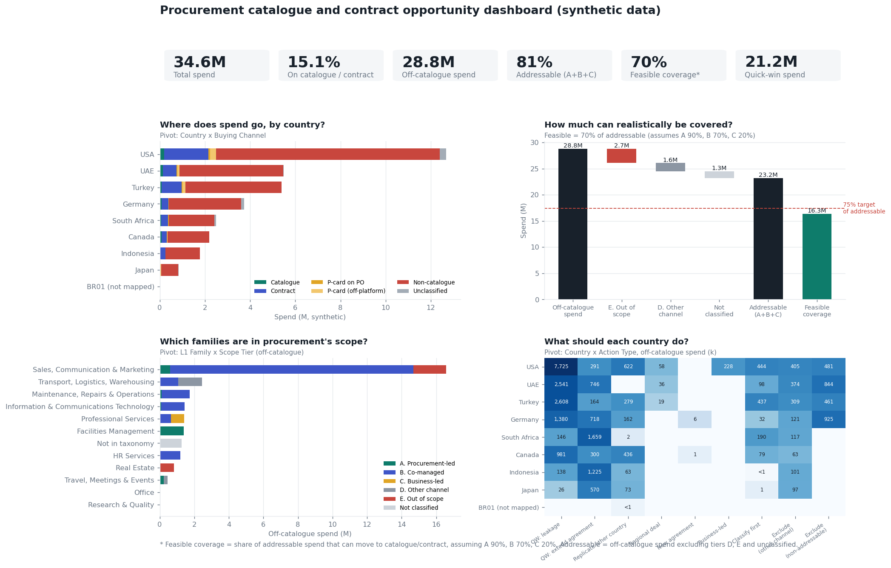
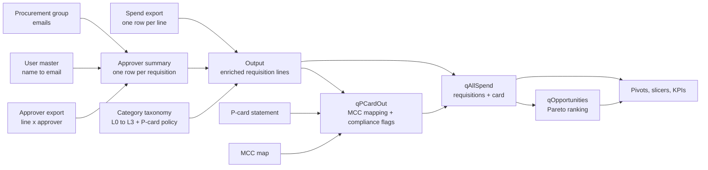
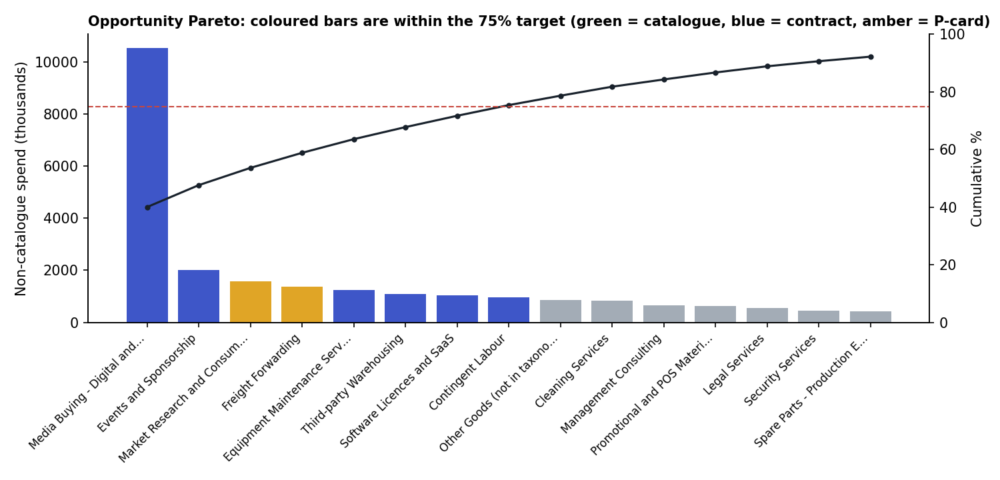
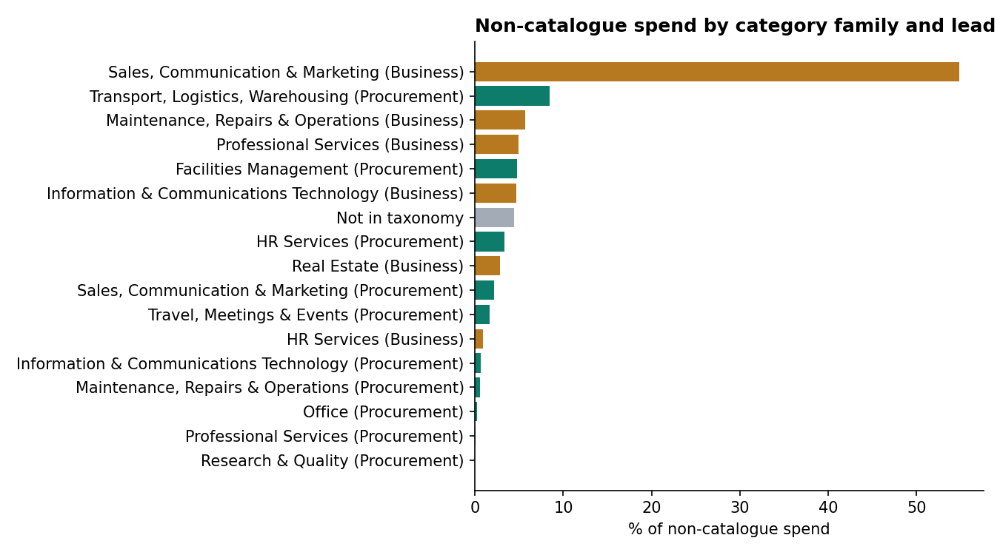

# Procurement Buying channel Algorithm 

An Excel-only pipeline that turns raw e-procurement exports and the P-card statement into a refreshable view of **how much spend goes through catalogues, contracts and P-cards**, **who actually approves it**, **whether card use follows policy**, and **which categories to move on-platform first**.

Built to support an e-procurement adoption programme across several countries. Everything runs inside Excel with Power Query and pivot tables, so the data never leaves the workbook. Monthly refresh is one click.

> All data in this repository is **synthetic**. Supplier names, people, emails and amounts are generated by `scripts/generate_sample_data.py`. No company data is included.



**[See all pivot views →](docs/pivots.md)** Eight charts, each answering one business question, with the pivot tables behind them.

| Question | Pivot view |
| --- | --- |
| Where does spend go, by country? | [Country x Buying Channel](docs/pivots.md#1-where-does-spend-go-by-country) |
| How much can realistically be covered? | [Coverage bridge by scope tier](docs/pivots.md#2-how-much-can-realistically-be-covered) |
| Which families are in procurement's scope? | [Family x Scope Tier](docs/pivots.md#3-which-families-are-in-procurements-scope) |
| What should each country do? | [Country x Action Type](docs/pivots.md#4-what-should-each-country-do) |
| Where are the quick wins? | [Quick wins by country](docs/pivots.md#5-quick-wins-spend-that-already-has-an-agreement) |
| Is procurement involved where it should be? | [Taxonomy intent x Approval route](docs/pivots.md#6-is-procurement-involved-where-it-should-be) |
| Is the channel mix changing? | [Month x Buying Channel](docs/pivots.md#7-is-the-channel-mix-changing-over-time) |
| What are the top opportunities? | [Top 10 with route](docs/pivots.md#8-top-10-opportunities-and-their-route) |

## The business questions

1. **How much spend is off-catalogue, by country and category?** Every non-catalogue line must be reported, so the category view has to reconcile to 100%.
2. **Where should catalogues and contracts be built?** The goal is a prioritised list of candidates covering a target share (75%) of non-catalogue spend.
3. **Is procurement involved where the taxonomy says it should be?** This compares the category's intended lead (procurement- or business-led) with who actually approved each requisition.
4. **What should each country do, commodity by commodity?** Countries are compared: an agreement that already exists in one country is the fastest route for another (see Country and commodity actions).
5. **Is the P-card used for the right things?** Card spend is categorised by merchant category code (MCC), checked against each category's P-card policy, and low-value one-off POs that belong on a card are identified.

## How it works



| Step | What happens | Why it matters |
| --- | --- | --- |
| Clean keys | Trim, collapse whitespace, replace non-breaking spaces, lowercase | Exports and taxonomies rarely match character for character |
| Taxonomy match | Match on the **short or long** commodity name; flag Matched, Unmapped, Ambiguous or Blank | Gives every line a category, and surfaces gaps instead of hiding them |
| Buying channel | Catalogue, Contract, Non-catalogue or Unclassified, **one value per line** | Spend stays additive, so pivots always reconcile |
| Approvers | Name to email via user master (active accounts first), email to procurement group, then collapse to **one row per requisition** | The approver export repeats lines per approver; joining it directly would multiply spend |
| Approval route | Procurement only, Business/Finance only, or both | Shows whether procurement was actually involved, not just whether it should have been |
| Dates | Parse source text dates as M/D/YYYY; add Month and PO Month | Prevents silent day/month swaps |
| Country | Map purchasing organisation codes to names; unknown codes show as `XX01 (not mapped)` | New countries are visible straight away |
| Opportunities | Rank non-catalogue commodities, running cumulative share, in-scope flag at the target, priority and suggested route | Turns analysis into an action list |

### Opportunity rules (`qOpportunities.pq`)

- **Catalogue** if the commodity is bought often in small amounts (at least 20 lines and an average of 1,000 or less per line).
- **Contract with top supplier** if one supplier holds at least 60% of the spend.
- **Contract, consolidate suppliers** if five or more suppliers are used.
- Otherwise **Contract**.
- **P-card (tail spend)** if the category's P-card policy is Allowed, at least half the lines are already on card or are non-catalogue POs of 500 or less, and the average line is small. If the average line is large, the route becomes **<contract route> + P-card for tail**.
- Card spend outside the taxonomy in a blocked MCC (cash, gambling, bars) is routed to **Prohibited: follow up with cardholder**.
- **P-card Action** tells you what to do with card use per commodity: keep on card and move low-value POs to card, review it, or stop it.
- **Priority:** High until 50% cumulative share, Medium until the target, Low after that.

All thresholds are settings at the top of the query.





## Scenarios covered by the sample data

The synthetic data is built so that every rule fires at least once: matching problems (unmapped, ambiguous, new country), every buying channel and approval route, every scope tier, every opportunity route, all nine country action types, the commodity plan variants and all P-card flags. `scripts/check_scenarios.py` checks 60 scenarios and currently passes all of them. See **[docs/scenarios.md](docs/scenarios.md)** for what each scenario means, how the data creates it and what you should see, and [docs/simulation/scenario_results.md](docs/simulation/scenario_results.md) for the latest run.

## Country and commodity actions

`qCountryActions` gives every country x commodity with off-catalogue spend one specific action, chosen in this order:

| Action type | When | Why it comes first |
| --- | --- | --- |
| Exclude | Scope tier D or E | Not part of the Ariba catalogue target |
| Classify first | No scope tier (not in taxonomy, ambiguous, or not in the scope matrix) | Scope must be decided before sourcing |
| Quick win: leakage | The top off-catalogue supplier already has a catalogue/contract in the same country | Agreement exists; only buying behaviour must change |
| Quick win: extend agreement | That supplier has a catalogue/contract in another country | Terms exist; ask the supplier to add the country |
| Replicate other country | The commodity is on catalogue/contract elsewhere with another supplier | A proven set-up to copy |
| Regional deal | The same top supplier is used off-catalogue in several countries | Combine volumes in one negotiation |
| Business-led | Scope tier C | Business selects; procurement reviews terms |
| New agreement | None of the above | Run the category playbook |

Priority is set within each country: High for the commodities making up the first 50% of the country's addressable off-catalogue spend, Medium up to 80%. `qCommodityPlan` rolls this up per commodity: quick-win countries, countries to copy a set-up to, and whether to aim for one regional agreement or local ones. Example output from the sample data: [docs/simulation/country_actions.csv](docs/simulation/country_actions.csv), [docs/simulation/commodity_plan.csv](docs/simulation/commodity_plan.csv).

## P-card simulation (optional module)

P-card is optional. Without a card programme the pipeline runs on Ariba requisitions alone: `qAllSpend` uses Output only, and `qOpportunities` drops all P-card logic and columns automatically when there are no card lines. To use it, load the card statement through `qPCardOut` and change one line in `qAllSpend.pq` (see the comment at the top). The Python preview always runs the full simulation.

The sample data includes a synthetic card statement with built-in policy breaches, so every check can be tested.

[](/msenthilkan/procurement-opportunity-analysis/blob/main/docs/images/pcard_compliance.png)

| What was simulated | How |
| --- | --- |
| Off-platform card buys | 1,100 transactions across 30 MCCs, weighted to low-value tail spend |
| Card-paid Ariba POs | About 30% of low-value non-catalogue POs in non-blocked categories are paid by card; each also appears on the statement with its PO number |
| Split purchases | 20 cases of 2-3 transactions, same cardholder, merchant and day, each under the limit and together above it |
| Over-limit buys | About 3% of transactions above the 2,500 single limit |
| Leakage | About 8% of card buys made with a supplier that already has a catalogue or contract |
| Prohibited MCCs | Cash withdrawals, bars and gambling |
| Low-value PO tail | 410 one-off requisitions under 500 (courier, training, venues, research, print) |

Result tables are in [docs/simulation/](docs/simulation/): `opportunities.csv`, `pcard_compliance_summary.csv`, `pcard_top50_noncompliant.csv` and `spend_by_country_channel.csv`. Rerun with the two scripts below; the numbers will match exactly because the generator is seeded.

## Repository layout

```
powerquery/
  Output.pq              main transformation of requisition lines (paste into Advanced Editor)
  qPCardOut.pq           card statement -> spend lines, MCC mapping, compliance flags
  qAllSpend.pq           appends requisitions and card lines into one table
  qTaxonomyPolicy.pq     optional: adds scope tier, category route and P-card policy from a scope matrix
  qCountryActions.pq     practical action per country x commodity (leakage, extend, replicate, regional, new)
  qCommodityPlan.pq      one plan per commodity across countries
  qOpportunities.pq      Pareto ranking, suggested route and P-card action
sample-data/             synthetic input files with the real export layouts (incl. qPCard, qMCCMap)
scripts/
  generate_sample_data.py   recreates the sample files, including the P-card simulation
  preview_dashboard.py      re-implements the logic in pandas to cross-check, draw charts and write docs/simulation/
  preview_country_actions.py  mirrors qCountryActions / qCommodityPlan on the sample data
  check_scenarios.py        checks that every scenario in docs/scenarios.md is triggered (PASS/FAIL)
  build_visuals.py          dashboard and pivot charts for docs/pivots.md
  sample_scope_matrix.py    scope tiers and routes for the sample commodities
docs/
  pivots.md              pivot views: one chart and table per business question
  scenarios.md           every scenario the sample data covers, explained
  setup-guide.md         step-by-step build in Excel
  dashboard-pivots.md    pivot recipes for the leadership slides
  design-notes.md        design decisions and problems solved
  simulation/            result tables from the P-card simulation
```

## Try it

1. Download `sample-data/` into one folder.
2. Follow [docs/setup-guide.md](docs/setup-guide.md). It takes about 30 minutes and covers loading the input files, pasting the queries, and loading the result tables.
3. Build the pivots in [docs/dashboard-pivots.md](docs/dashboard-pivots.md).

To check the logic without Excel:

```bash
pip install pandas openpyxl matplotlib
python scripts/generate_sample_data.py
python scripts/preview_dashboard.py
python scripts/preview_country_actions.py
python scripts/check_scenarios.py
python scripts/build_visuals.py
```

## Skills demonstrated

Power Query M (custom functions, record lookups, grouping, nested joins, running totals), data modelling at the right grain, reconciliation and data-quality checks, Pareto prioritisation, pivot-based reporting, and turning a manual VLOOKUP process into a refreshable pipeline.

## License

MIT
