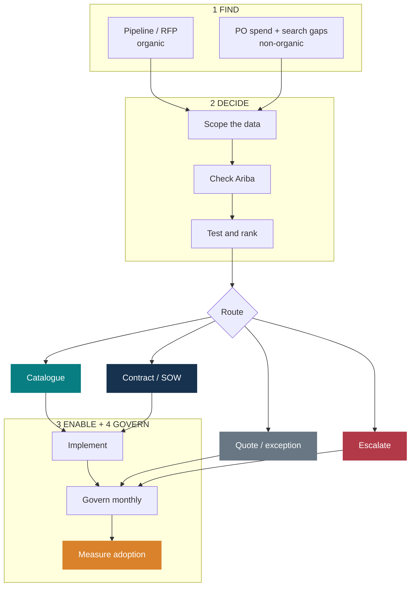
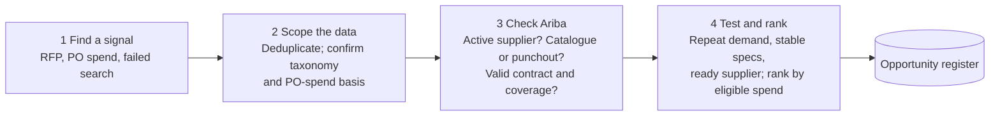
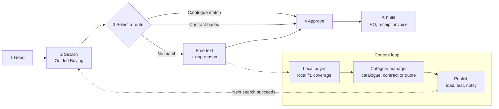
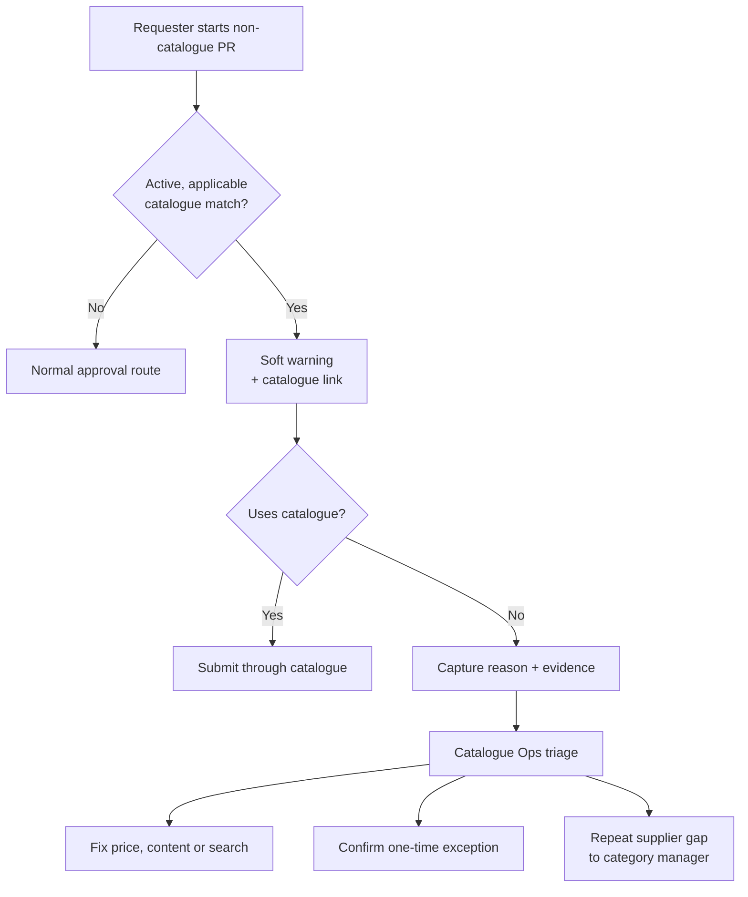
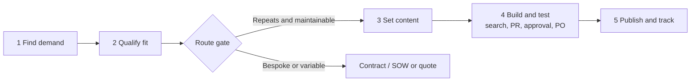
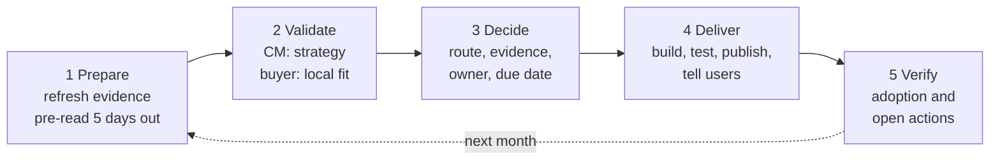

# Buying-channel governance playbook

**From off-catalogue spend to governed buying channels: find it, route it, make it easy, prove it.**

This page is the discussion version of the programme storyline. Each section starts with its key message, followed by the flow behind it. Comments and challenges are welcome: open an issue or a discussion and reference the section number.

> All examples are generic. The companion analytics in this repository use **synthetic data**. Validate every Ariba configuration point in the target tenant before implementation.

---

## The story in one page

| | Message | What it means |
| --- | --- | --- |
| **Situation** | The money is mapped. Buying behaviour hasn't moved. | Most PO spend still goes through non-catalogue channels, even though the opportunities are already ranked. |
| **Complication** | The coverage target looks met on paper. It isn't proven. | Out-of-scope categories and different spend denominators change the answer. |
| **Resolution** | Find. Decide. Enable. Govern. | One path from every opportunity to proven adoption. |
| **Ask** | Four decisions unlock the next 90 days. | Spend basis, exclusions, governance owner and Ariba fit-gap. See [Questions for discussion](#9-questions-for-discussion). |

---

## 1. One path from every opportunity to adoption

**Two sources in. Three checks. One recorded route. Governed until it's used.**

**Rule:** no opportunity leaves this path without a route, an owner and a due date.

---

## 2. Move 1 · Find: Two sources. One register.

**Catch demand at the RFP, or find it in what we already buy.**

| | Pipeline-led (organic) | Spend-led (non-organic) |
| --- | --- | --- |
| **Trigger** | An RFP or tender is planned, active or moving to award | Recurring, concentrated or fragmented non-catalogue demand outside an active RFP |
| **Play** | Split repeatable lines from bespoke scope **before award** | Group by country, company, L3 and supplier; confirm with procurement |
| **Example** | A facility-management tender moving to award | Displays: catalogue repeat specs, quote bespoke work |

**One register, one opportunity:** deduplicate by country, company, L3, supplier and period. Keep the source ID.

---

## 3. Move 2 · Decide: Every opportunity gets one route, chosen from evidence

### Qualify before you route

Use **supplier ID and commodity code** as match keys. A supplier-name or description match alone does not prove an active catalogue covers the item and location.

### Catalogue or contract? Fit the channel to the buy.

| | Catalogue | Contract |
| --- | --- | --- |
| **What it is** | What the requester can search and select | What we negotiated: scope, rates, term |
| **Needs / controls** | Description, supplier, unit, price, validity, company and country coverage | Covered entities, scope, rates, dates, terms and obligations |
| **Best fit** | Repeatable specs, stable prices | Negotiated or bespoke services, SOWs |
| **Example** | Standard display items; rate-card lines | Agency MSA with project SOWs |

**Use both** when contract rates can become catalogue lines. **Watch out:** contract-linked spend can still be non-catalogue.

### Route options

| Route | Use when | Next action |
| --- | --- | --- |
| Catalogue | Repeatable item or service; coverage can be maintained | Build, test and publish content |
| Contract / SOW | Negotiated rates or project-based services | Confirm agreement coverage and SOW controls |
| Quote / exception | Variable demand or no reusable content | Record reason and evidence; review recurrence |
| Escalate | Scope, taxonomy or policy question | Owner confirms before excluding or reclassifying |

Don't force everything into catalogues. Media, professional services and project work often fit a contract/SOW better.

---

## 4. Move 3 · Enable

### 4A. Make the right route the easy route

**A failed search becomes a content fix, not a dead end.**

**Success =** supplier, scope, price and entity/country coverage are all valid.

### 4B. Every bypass becomes a fix, not a leak

**A soft warning, not a block: exceptions stay possible, but each one is explained.**

| Requester reasons | Catalogue Ops action |
| --- | --- |
| Quote lower than catalogue (attach it) | Verify evidence; correct price |
| Item or service missing | Add content or onboard supplier |
| Delivery, entity or timing doesn't fit | Extend regional coverage |
| Other (explanation required) | Confirm exception or fix the root cause |

> **Ariba fit-gap:** guided buying justification is optional by default. Validate the mandatory reason, the supplier × commodity × region lookup, warning timing and data source with the Ariba product owner before build.

### 4C. Build once. Test end to end. Publish and track.

| Owner | Role |
| --- | --- |
| Category manager | Sets supplier and route |
| Local buyer | Confirms country fit |
| Content owner | Loads, tests, publishes |

**Preferred suppliers first.** Compare preferred suppliers by L3 and region with active content. Every gap gets a sponsor, owner and due date. The preferred-supplier list is a coverage input, not proof that content exists.

---

## 5. Move 4 · Govern: One review. One register. Named owners.

**Five steps every month turn evidence into decisions, owned changes and a measured result.**

**Every opportunity leaves with one decision:** build catalogue · contract/SOW · keep quote route · escalate.

| Standing role | Monthly responsibility |
| --- | --- |
| Global / regional category manager | Category strategy, supplier choice, catalogue vs contract |
| Country buyer | Local demand, entity, language, tax and delivery |
| Catalogue / contract owners | Maintain data, resolve bypass cases, publish |
| Ariba product owner / IT | Tenant feasibility, controls, testing and release |
| Business, Finance, Legal, Tax | Join when their decision is needed |

**Action register fields:** country · company · L3 · supplier · spend and source · decision and evidence · owner · due date · status · adoption result.

---

## 6. Measure: on paper is not proven

**A headline ratio is only as good as its denominator and scope.**

Three gates before reporting a coverage target:

1. **One denominator.** Same PO-spend basis, period, countries and currency for numerator and denominator.
2. **Visible exclusions.** Rebates, agent commissions or leases may not be addressable. Keep them visible with a reason.
3. **Reconciled to source.** The ranking base must tie back to total PO spend in the extract.

| Measure | Calculation | Tells you |
| --- | --- | --- |
| Candidate coverage | Addressable spend with a validated route ÷ addressable spend | Is the plan big enough for the target? |
| Realized adoption | Spend through catalogue or contract ÷ addressable spend | Is behaviour actually changing? |
| Bypass rate | Matched requests that still went non-catalogue ÷ all matched | Where do content, price or search need work? |
| Content availability | Preferred supplier × commodity × region with usable content ÷ in scope | Is onboarding closing gaps? |
| Closure performance | Actions closed by due date ÷ actions due | Do decisions turn into delivery? |

Never count a proposed route as adoption until transactions confirm it.

---

## 7. Multi-language descriptions

Match on **stable IDs first**, taxonomy and approved synonyms second, translated similarity last (candidates only). Keep the original description, add the translation as a separate field, and log the reviewer's decision.

---

## 8. The story in 60 seconds

> "We know where the off-catalogue money is, but coverage isn't proven until we agree one denominator and keep exclusions visible. Every opportunity follows one path: find it in the pipeline or the spend, qualify it, record one route, then make that route the easy choice for requesters. Bypasses become fixes, not leaks. One monthly review with named owners checks adoption from transactions, not plans."

---

## 9. Questions for discussion

1. **Spend basis.** Which denominator do we report the coverage target against, and do excluded categories leave it?
2. **Exclusions.** Who approves out-of-scope categories, or their reclassification?
3. **Governance owner.** Who chairs the monthly review, and who must attend?
4. **Ariba fit-gap.** Can the tenant enforce a required bypass reason and a supplier × commodity × region coverage lookup through standard configuration?
5. **Success definition.** Do we agree a search counts as successful only when supplier, scope, price and entity/country coverage are all valid?
