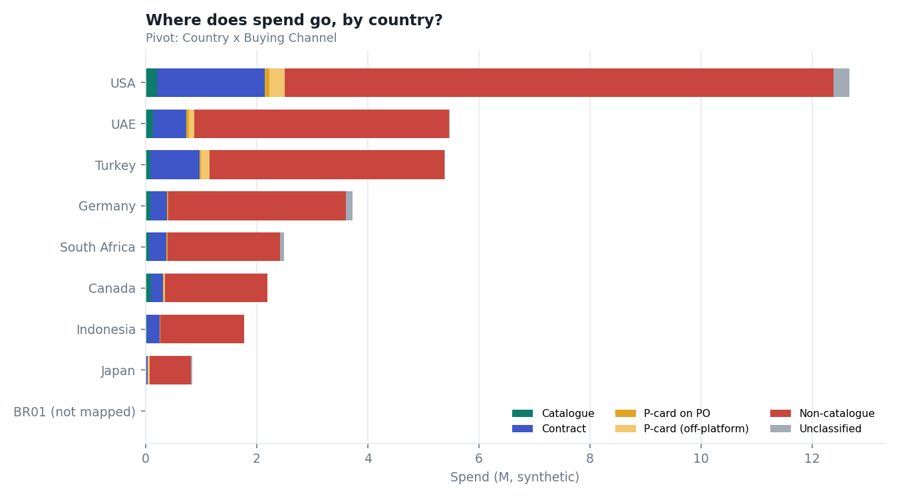
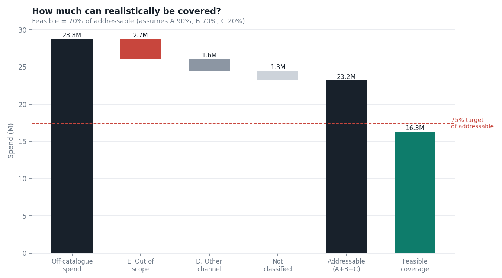
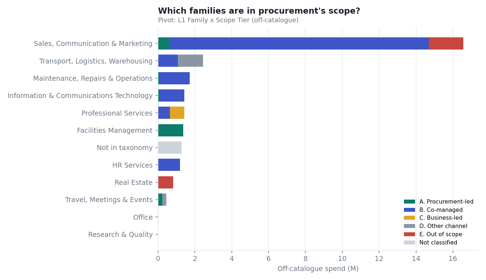
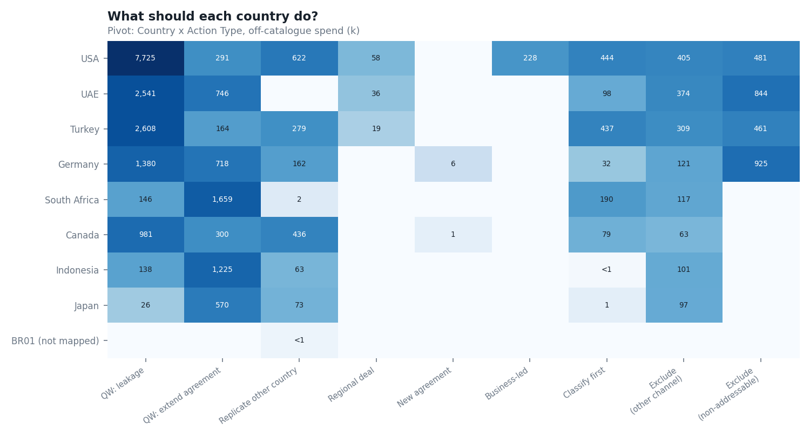
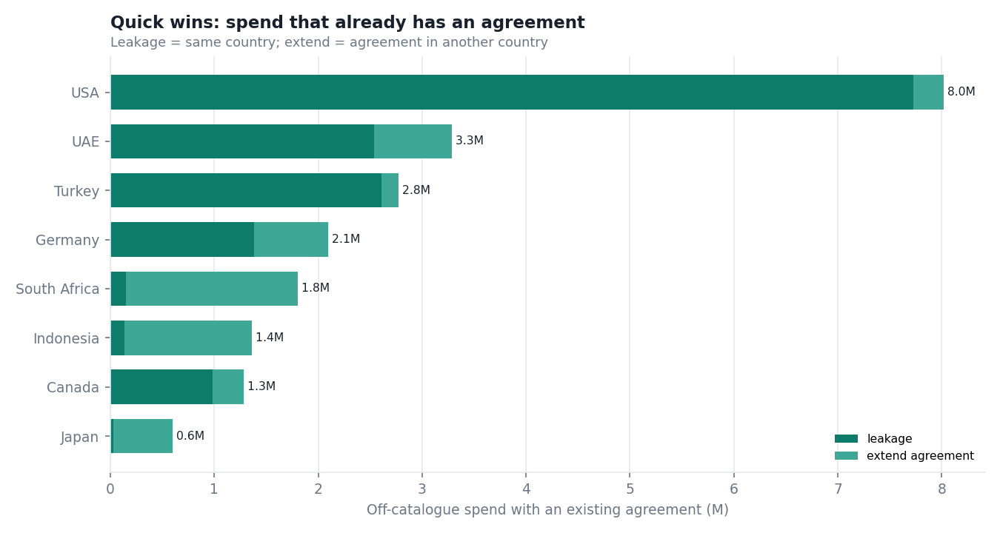
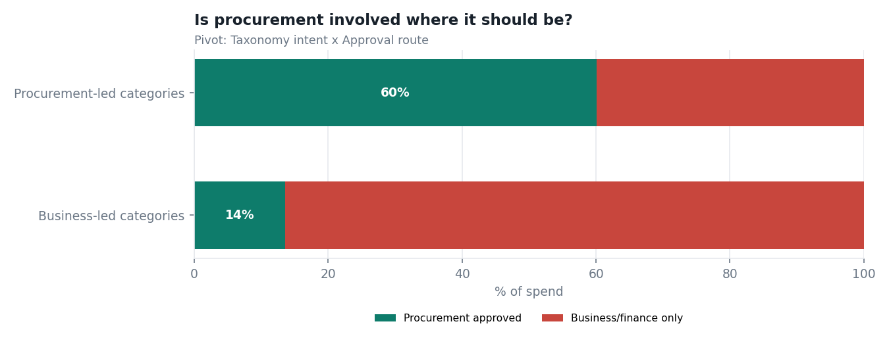
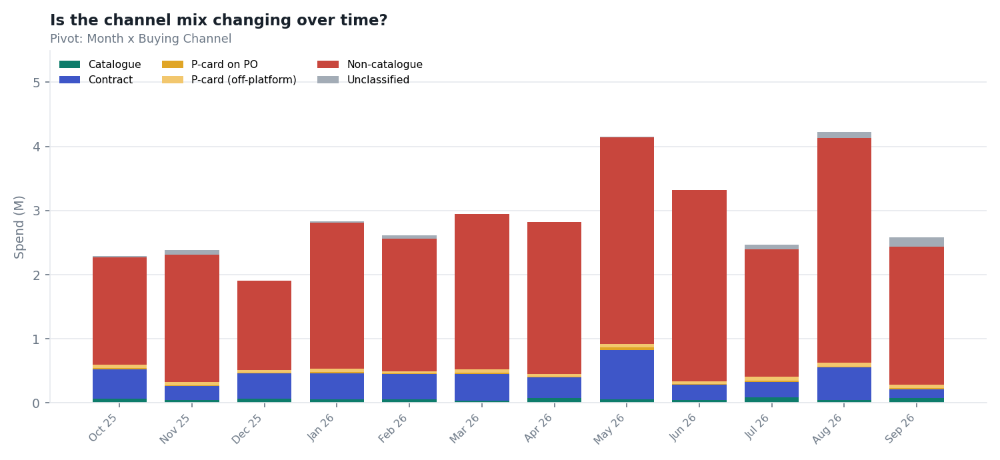
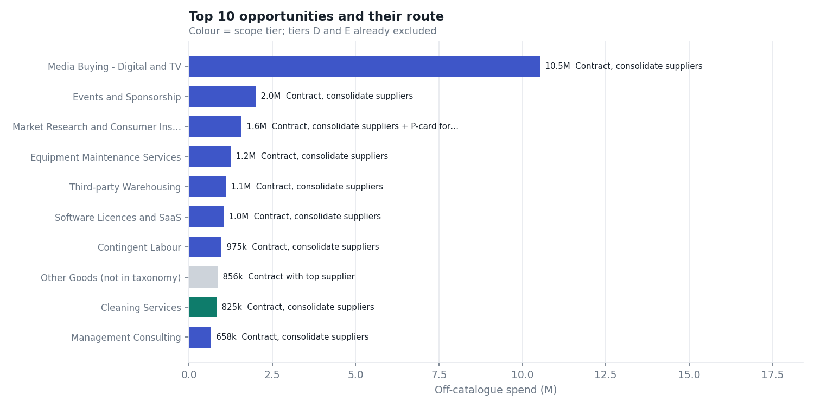

# Pivot views

Every chart answers one business question and is built from a pivot on the query output, exactly as you would in Excel
(recipes in [dashboard-pivots.md](dashboard-pivots.md)). All numbers are **synthetic**. Regenerate with
`python scripts/build_visuals.py`.

## 1. Where does spend go, by country?

Pivot on **Output / AllSpend**: rows `Country`, columns `Buying Channel`, values `sum(PO Spend)`.

| Country | Catalogue | Contract | P-card on PO | P-card (off-platform) | Non-catalogue | Unclassified | Total | On catalogue/contract % |
| --- | ---: | ---: | ---: | ---: | ---: | ---: | ---: | ---: |
| USA | 206,619 | 1,940,114 | 80,868 | 274,140 | 9,892,541 | 280,766 | 12,675,048 | 16.9% |
| UAE | 137,050 | 597,425 | 40,977 | 104,731 | 4,585,684 | 12,463 | 5,478,331 | 13.4% |
| Turkey | 78,380 | 889,836 | 30,793 | 148,698 | 4,236,801 | 8,908 | 5,393,416 | 18.0% |
| Germany | 90,031 | 294,341 | 24,969 | 0 | 3,198,810 | 119,320 | 3,727,471 | 10.3% |
| South Africa | 61,414 | 314,391 | 25,500 | 0 | 2,020,369 | 68,992 | 2,490,666 | 15.1% |
| Canada | 91,067 | 226,180 | 10,185 | 18,577 | 1,846,350 | 2,295 | 2,194,653 | 14.5% |
| Indonesia | 23,534 | 222,706 | 12,606 | 0 | 1,514,658 | 140 | 1,773,644 | 13.9% |
| Japan | 18,037 | 13,536 | 3,706 | 37,225 | 736,910 | 26,766 | 836,180 | 3.8% |
| BR01 (not mapped) | 0 | 0 | 0 | 0 | 588 | 0 | 588 | 0.0% |

**Read it as:** only 15.1% of spend runs through a catalogue or contract today; the rest is the opportunity.

## 2. How much can realistically be covered?

Pivot on **Output**: filter `Buying Channel` = off-catalogue, rows `Taxonomy.Scope Tier`. The bridge removes non-addressable (E),
other-channel (D) and not-yet-classified spend, then applies the coverage assumptions from the scope workbook.

| Tier | Off-catalogue spend | Share | Coverage assumption |
| --- | ---: | ---: | --- |
| A. Procurement-led | 2,442,663 | 8.5% | 90% |
| B. Co-managed | 19,977,120 | 69.4% | 70% |
| C. Business-led | 784,236 | 2.7% | 20% |
| D. Other channel | 1,586,216 | 5.5% | excluded |
| E. Out of scope | 2,710,931 | 9.4% | excluded |
| Not classified | 1,280,801 | 4.5% | excluded |

**Read it as:** addressable spend is 23.2M; feasible coverage is 16.3M, or 70% of
addressable, against a 75% target. Reporting on *total* off-catalogue spend would understate what procurement can influence.

## 3. Which families are in procurement's scope?

Pivot on **Output**: rows `Taxonomy.Level 1 (Family)`, columns `Taxonomy.Scope Tier`, filter off-catalogue.

| Family | A. Procurement-led | B. Co-managed | C. Business-led | D. Other channel | E. Out of scope | Not classified | Total |
| --- | ---: | ---: | ---: | ---: | ---: | ---: | ---: |
| Sales, Communication & Marketing | 590,987 | 14,098,290 | 0 | 0 | 1,883,846 | 0 | 16,573,123 |
| Transport, Logistics, Warehousing | 1,032 | 1,080,737 | 0 | 1,363,085 | 0 | 0 | 2,444,854 |
| Maintenance, Repairs & Operations | 107,053 | 1,623,049 | 0 | 0 | 0 | 0 | 1,730,101 |
| Information & Communications Technology | 91,988 | 1,337,685 | 0 | 0 | 0 | 0 | 1,429,673 |
| Professional Services | 7,549 | 635,096 | 784,236 | 0 | 0 | 0 | 1,426,880 |
| Facilities Management | 1,380,182 | 0 | 0 | 0 | 0 | 0 | 1,380,182 |
| Not in taxonomy | 0 | 0 | 0 | 0 | 0 | 1,276,024 | 1,276,024 |
| HR Services | 0 | 1,202,263 | 0 | 0 | 0 | 0 | 1,202,263 |
| Real Estate | 0 | 0 | 0 | 0 | 827,085 | 0 | 827,085 |
| Travel, Meetings & Events | 240,272 | 0 | 0 | 223,131 | 0 | 0 | 463,404 |
| Office | 23,600 | 0 | 0 | 0 | 0 | 0 | 23,600 |
| Research & Quality | 0 | 0 | 0 | 0 | 0 | 4,777 | 4,777 |

## 4. What should each country do?

Pivot on **qCountryActions**: rows `Country`, columns `Action Type`, values `Off-catalogue Spend`.

| Country | Quick win: leakage | Quick win: extend agreement | Replicate other country | Regional deal | New agreement | Business-led | Classify first | Exclude (other channel) | Exclude (non-addressable) |
| --- | ---: | ---: | ---: | ---: | ---: | ---: | ---: | ---: | ---: |
| BR01 (not mapped) | 0 | 0 | 588 | 0 | 0 | 0 | 0 | 0 | 0 |
| Canada | 980,601 | 299,611 | 435,507 | 0 | 1,279 | 0 | 79,270 | 62,562 | 0 |
| Germany | 1,379,830 | 717,826 | 161,918 | 0 | 6,270 | 0 | 31,877 | 120,713 | 924,666 |
| Indonesia | 138,130 | 1,224,927 | 63,384 | 0 | 0 | 0 | 203 | 100,761 | 0 |
| Japan | 25,993 | 570,308 | 72,598 | 0 | 0 | 0 | 1,464 | 97,020 | 0 |
| South Africa | 146,285 | 1,659,464 | 2,097 | 0 | 0 | 0 | 189,587 | 117,429 | 0 |
| Turkey | 2,607,774 | 163,970 | 278,789 | 19,393 | 0 | 0 | 437,245 | 308,591 | 460,741 |
| UAE | 2,540,982 | 746,072 | 0 | 35,921 | 0 | 0 | 97,654 | 374,148 | 844,347 |
| USA | 7,724,546 | 291,224 | 622,423 | 58,317 | 0 | 227,992 | 443,502 | 404,994 | 481,177 |

| Action Type | Rows | Spend |
| --- | --- | ---: |
| Quick win: leakage | 84 | 15,544,140 |
| Quick win: extend agreement | 49 | 5,673,401 |
| Replicate other country | 19 | 1,637,304 |
| Regional deal | 3 | 113,631 |
| New agreement | 2 | 7,549 |
| Business-led | 1 | 227,992 |
| Classify first | 15 | 1,280,801 |
| Exclude (other channel) | 16 | 1,586,216 |
| Exclude (non-addressable) | 6 | 2,710,931 |

## 5. Quick wins: spend that already has an agreement

Pivot on **qCountryActions** filtered on `Action Type` starting with "Quick win". These need no sourcing event: either
requesters bypass an agreement that exists in their own country (leakage), or the supplier already has one in another
country that can be extended.

## 6. Is procurement involved where it should be?

Pivot on **Output**: rows `Taxonomy.Procurement Or Business Led`, columns `Approval Route`.

| Procurement Or Business Led | Business/Finance only | No approval data | Procurement + Business/Finance | Procurement only |
| --- | ---: | ---: | ---: | ---: |
| Business Led | 21,355,885 | 38,372 | 3,355,110 | 0 |
| Procurement Led | 3,054,023 | 0 | 4,596,047 | 337 |

## 7. Is the channel mix changing over time?

Pivot on **Output**: rows `Month`, columns `Buying Channel`.

## 8. Top 10 opportunities and their route

From **qOpportunities** (tiers D and E excluded, category route applied).

| Commodity | Scope tier | Off-catalogue spend | Suggested route |
| --- | --- | ---: | --- |
| Media Buying - Digital and TV | B. Co-managed | 10,525,300 | Contract, consolidate suppliers |
| Events and Sponsorship | B. Co-managed | 1,998,832 | Contract, consolidate suppliers |
| Market Research and Consumer Insights | B. Co-managed | 1,575,813 | Contract, consolidate suppliers + P-card for tail |
| Equipment Maintenance Services | B. Co-managed | 1,245,965 | Contract, consolidate suppliers |
| Third-party Warehousing | B. Co-managed | 1,099,027 | Contract, consolidate suppliers |
| Software Licences and SaaS | B. Co-managed | 1,033,023 | Contract, consolidate suppliers |
| Contingent Labour | B. Co-managed | 974,748 | Contract, consolidate suppliers |
| Other Goods (not in taxonomy) | Not classified | 856,460 | Contract with top supplier |
| Cleaning Services | A. Procurement-led | 824,601 | Contract, consolidate suppliers |
| Management Consulting | B. Co-managed | 658,433 | Contract, consolidate suppliers |
